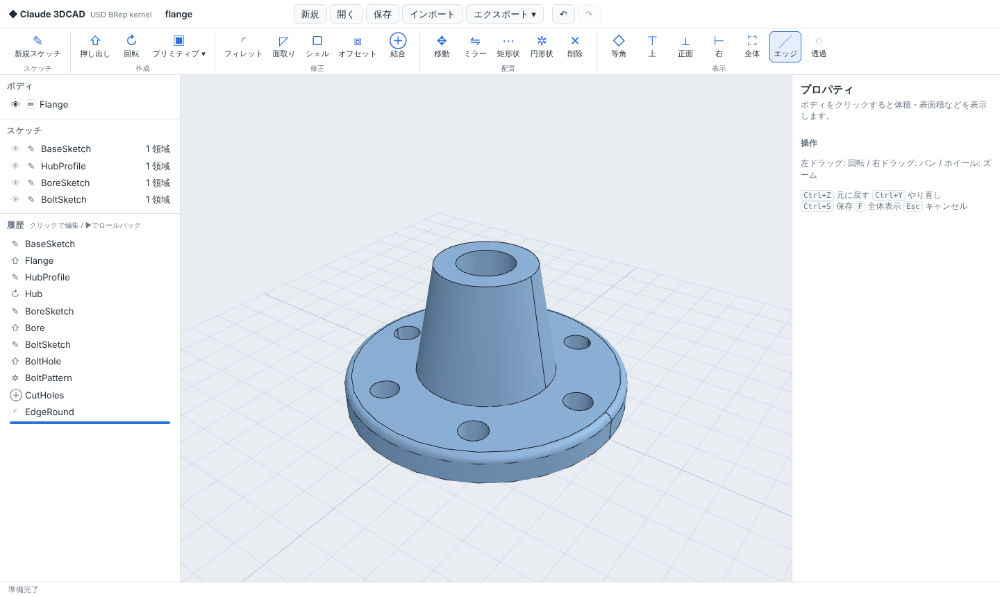

# Claude 3DCAD

[NVIDIA USD BRep](https://github.com/NVIDIA-Omniverse/usd-brep)（SMLib NURBS 境界表現ソリッドモデリングカーネル）を使った、
ブラウザで動くパラメトリック 3D CAD アプリです。

- **カーネル**: `usd-brep`（PyPI の wheel）。形状はすべて厳密な NURBS / 解析曲面の BRep として保持
- **バックエンド**: Python (FastAPI)。フィーチャー履歴を保持し、変更のたびに再生成
- **フロントエンド**: Three.js（同梱、外部 CDN 不要）



`examples/flange.c3d.json` を「開く」で読み込むと、上のフランジ（円柱＋回転＋穴あけ＋円形状パターン＋フィレット）を履歴付きで確認できます。

## 起動

Python 3.12 が必要です（`usd-brep` は cp312 の wheel のみ提供。Linux x86_64/aarch64、Windows）。

**Windows**: Python 3.12 (64-bit) をインストールし、`run.bat` をダブルクリックします
（初回のみ数分のセットアップ後、ブラウザが自動で開きます）。

**Linux**:

```bash
./run.sh                 # .venv を作成して http://127.0.0.1:8000/ で起動
./run.sh --port 9000     # ポート変更
```

手動で行う場合:

```bash
uv venv -p 3.12 .venv && uv pip install -p .venv/bin/python -e ".[dev]"
.venv/bin/python -m cad3d.server
```

## 機能

| 分類 | 機能 |
|---|---|
| プリミティブ | ボックス、円柱、球、円錐（円錐台）、トーラス、角錐 |
| スケッチ | 押し出し（長方形 / 円 / 正多角形 / 自由形状スケッチ、XY・XZ・YZ 平面＋オフセット、対称）、回転（R-Z スケッチを Z 軸まわり） |
| 修正 | フィレット、面取り（エッジをクリック選択）、シェル（開口面をクリック選択）、オフセット、ブーリアン（和・差・積） |
| 配置 | 移動／回転／スケール（コピー可）、ミラー、矩形状パターン、円形状パターン、ボディ削除 |
| 履歴 | 全フィーチャーをパラメトリックに再編集、ロールバック、抑制、ドラッグで並べ替え、元に戻す／やり直し |
| 解析 | 体積、表面積、重心、バウンディングボックス、面／エッジ／頂点数、閉じたソリッド判定 |
| ファイル | プロジェクト保存・読込（`.c3d.json`）、USD BRep (`BrepArray`) インポート／エクスポート、USD Mesh・STL エクスポート |

押し出し・回転は「新規ボディ / 結合 / 切り取り / 交差」を選べます。

### 操作

- 左ドラッグ: 回転 / 右ドラッグ: パン / ホイール: ズーム
- `Ctrl+Z` 元に戻す、`Ctrl+Y` やり直し、`Ctrl+S` 保存、`Ctrl+O` 開く、`F` 全体表示、`Esc` キャンセル、`Enter` 確定
- 履歴の項目をクリックすると、その時点までロールバックした状態でパラメータを編集できます

## 設計

```
web/ (Three.js UI)  ──HTTP/JSON──▶  cad3d/server.py (FastAPI)
                                       │
                                       ▼
                                cad3d/document.py   フィーチャー履歴・再生成・Undo/Redo・キャッシュ
                                       │
                                       ▼
                                cad3d/kernel.py     usd_brep (SMLib) の薄いラッパー
```

- ドキュメントは JSON のフィーチャー列です。再生成時は各フィーチャーを順に適用し、失敗したフィーチャーは
  エラー表示して後続の処理は続行します。
- カーネルの結果は「ボディの履歴シグネチャ」をキーにキャッシュするので、末尾のフィーチャーを編集しても
  上流は再計算されません。
- フィレット／シェルの面・エッジ参照は「エンティティ上の点」と「その点をボディのバウンディングボックスで
  正規化した座標」で保存し、再生成ごとに最も近いエンティティへ解決します。上流の寸法を変えても
  参照が追従します（いわゆるトポロジカルネーミング問題への簡易対策）。
- 表示用メッシュは `tessellate` で生成し、エッジは `tessellate_boundaries` のポリラインをそのまま描画・ピッキングに使います。

## テスト

```bash
.venv/bin/python -m pytest
```

## 既知の制限

- カーネルの `shell_brep` は、フィレット済みの面を含むボディなどで失敗したり体積 0 の結果を返すことがあります。
  その場合はフィーチャーがエラーとして表示されます。
- USD の初回入出力時、OpenUSD が `pxr` Python モジュールを探す警告を標準エラーに出しますが動作には影響しません。
- サーバーはシングルユーザー・単一ドキュメントです（ローカル利用を想定）。

## サードパーティ

- `usd-brep`（Apache-2.0、NVIDIA）は pip 依存として取得します。
- 同梱の Three.js r160 は MIT ライセンスです（`web/vendor/three.LICENSE`）。
