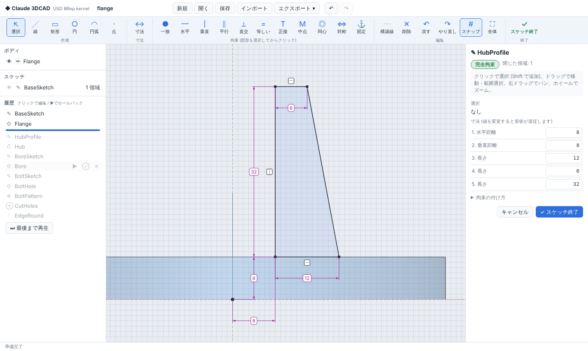

# Claude 3DCAD

[NVIDIA USD BRep](https://github.com/NVIDIA-Omniverse/usd-brep)（SMLib NURBS 境界表現ソリッドモデリングカーネル）を使った、
ブラウザで動くパラメトリック 3D CAD アプリです。

- **カーネル**: `usd-brep`（PyPI の wheel）。形状はすべて厳密な NURBS / 解析曲面の BRep として保持
- **バックエンド**: Python (FastAPI)。フィーチャー履歴を保持し、変更のたびに再生成
- **フロントエンド**: Three.js（同梱、外部 CDN 不要）


**スケッチ → フィーチャー** 型のパラメトリック CAD です。寸法と幾何拘束の付いた 2D スケッチを描き、
押し出し・回転で立体にし、フィレットや穴あけで仕上げます。スケッチの寸法を後から変えると、
それを使うフィーチャーがすべて自動で作り直されます。



`examples/flange.c3d.json` を「開く」で読み込むと、上のフランジ（完全拘束のスケッチ 4 つ＋押し出し・回転・穴・パターン・フィレット）を
履歴付きで確認できます。

## 起動

Python 3.12 が必要です（`usd-brep` は cp312 の wheel のみ提供。Linux x86_64/aarch64、Windows）。

**Windows**: Python 3.12 (64-bit) をインストールし、`run.bat` をダブルクリックします
（初回のみ数分のセットアップ後、ブラウザが自動で開きます）。

**Linux**:

```bash
./run.sh                 # .venv を作成して http://127.0.0.1:8765/ で起動（使用中なら次の空き番号）
./run.sh --port 9000     # ポート変更
```

手動で行う場合:

```bash
uv venv -p 3.12 .venv && uv pip install -p .venv/bin/python -e ".[dev]"
.venv/bin/python -m cad3d.server
```

## 使い方 (基本の流れ)

1. **新規スケッチ** → 平面 (XY / XZ / YZ) を選ぶか、ボディの平らな面をクリック
2. **線・矩形・円・円弧** で形を描く（既存の点にスナップすると自動で接続、水平/垂直は自動で拘束）
3. **寸法 (D)** で線・円をクリックして寸法値を入力。図形を選んで **拘束** ボタンで関係を指定
4. 右パネルが **「完全拘束」** になったら **スケッチ終了**
5. **押し出し / 回転** で立体に。結果はオレンジ色でライブプレビューされます
6. 面にスケッチして **切り取り** 押し出しで穴あけ、**フィレット / 面取り** で仕上げ
7. 履歴のスケッチをクリックして寸法を変えると、モデル全体が追従します

## 機能

| 分類 | 機能 |
|---|---|
| スケッチ作図 | 線（連続）、矩形、円、円弧（中心・始点・終点）、点、構築線、削除、スケッチ内の元に戻す／やり直し、グリッドスナップ |
| 寸法 | 長さ、距離（平行・水平・垂直）、点と線の距離、半径、直径、角度。値は式入力可（例 `20/2+5`）。右パネルの寸法一覧からも変更可 |
| 幾何拘束 | 一致、水平、垂直、平行、直交、等しい、正接、中点、同心、対称、固定、点を線/円上に |
| 拘束状態 | 自由度の表示、完全拘束の図形は黒・未拘束は青で表示、矛盾する拘束や冗長な拘束は追加を拒否 |
| スケッチ平面 | XY / XZ / YZ ＋オフセット、ボディの平面上 |
| フィーチャー | 押し出し（距離・対称・すべて貫通、反転）、回転（スケッチ軸または線を軸に）。どちらも新規ボディ／結合／切り取り／交差 |
| 修正 | フィレット、面取り（エッジをクリック）、シェル（開口面をクリック）、オフセット、ブーリアン |
| 配置 | 移動／回転／スケール（コピー可）、ミラー、矩形状パターン、円形状パターン、ボディ削除 |
| プリミティブ | ボックス、円柱、球、円錐、トーラス、角錐（リボンの「プリミティブ ▾」） |
| 履歴 | 全フィーチャーをパラメトリックに再編集、ライブプレビュー、ロールバック、抑制、並べ替え、元に戻す／やり直し |
| 解析・ファイル | 体積・表面積・重心など。プロジェクト保存/読込（`.c3d.json`）、USD BRep インポート/エクスポート、USD Mesh・STL エクスポート |

### 操作

- 3D ビュー: 左ドラッグ 回転 / 右ドラッグ パン / ホイール ズーム、`F` 全体表示
- スケッチ: 右ドラッグ パン / ホイール ズーム、`L` 線 `R` 矩形 `C` 円 `A` 円弧 `P` 点 `D` 寸法 `S` 選択 `X` 構築線 `H` 水平 `V` 垂直 `Delete` 削除 `Esc` ツール終了
- `Ctrl+Z` 元に戻す、`Ctrl+Y` やり直し、`Ctrl+S` 保存、`Ctrl+O` 開く

## 設計

```
web/                          Three.js UI
  sketch/solver.js            幾何拘束ソルバー（ガウス・ニュートン法 + 自由度解析）
  sketch/editor.js            スケッチエディタ（作図・寸法・拘束・ドラッグ）
  viewer.js / forms.js / app.js
        │ HTTP/JSON
        ▼
cad3d/server.py               FastAPI
cad3d/document.py             フィーチャー履歴・再生成・プレビュー・Undo/Redo・キャッシュ
cad3d/sketch.py               スケッチのデータ構造、閉じた領域（プロファイル）の検出
cad3d/kernel.py               usd_brep (SMLib) の薄いラッパー
```

- **スケッチ**は点・線・円・円弧と拘束の JSON です。拘束はブラウザ側のソルバーで解き、解いた座標を保存します。
  点を共有して図形をつなぐため、サーバー側は平面グラフの面を辿るだけで閉じた領域（穴を含む）を求められます。
- **ソルバー**は拘束を残差方程式にし、重み付き最小ノルムのガウス・ニュートン法で解きます（ドラッグ中の点は動きにくく重み付け）。
  ヤコビ行列のランクから自由度を求め、各点が完全に決まっているかを判定します。
- **押し出し／回転**はプロファイルの参照を「領域内の 2D 点」で保存するので、スケッチの寸法を変えても同じ領域を選び続けます。
- カーネルの結果は「ボディの履歴シグネチャ（スケッチの内容を含む）」をキーにキャッシュし、編集箇所より上流は再計算しません。
- フィレット／シェルの面・エッジ参照は「エンティティ上の点」と「ボディのバウンディングボックスで正規化した座標」で保存し、
  再生成ごとに最も近いエンティティへ解決します（トポロジカルネーミング問題への簡易対策）。

## テスト

```bash
.venv/bin/python -m pytest              # カーネル・履歴・スケッチ・API
node --test tests/js/*.test.mjs         # 拘束ソルバー
```

## 既知の制限

- カーネルの `shell_brep` は、フィレット済みの面を含むボディなどで失敗したり体積 0 の結果を返すことがあります。
  その場合はフィーチャーがエラーとして表示されます。
- USD の初回入出力時、OpenUSD が `pxr` Python モジュールを探す警告を標準エラーに出しますが動作には影響しません。
- スケッチ要素どうしの交差は自動で分割しません（交差する線で領域を区切るには、交点に点を共有させて描きます）。トリム・延長・フィレット（2D）は未対応です。
- v0.1 形式（スケッチを使わない押し出し／回転）のフィーチャーは再生成できますが、パラメータ編集はできません。
- サーバーはシングルユーザー・単一ドキュメントです（ローカル利用を想定）。

## サードパーティ

- `usd-brep`（Apache-2.0、NVIDIA）は pip 依存として取得します。
- 同梱の Three.js r160 は MIT ライセンスです（`web/vendor/three.LICENSE`）。
